# ChompChamp

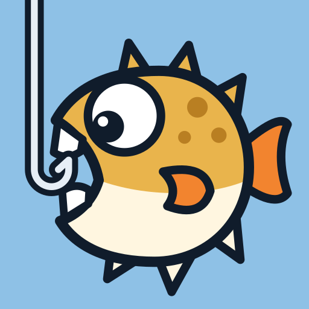

A free, offline fishing chartplotter for Android. Western Australia first.

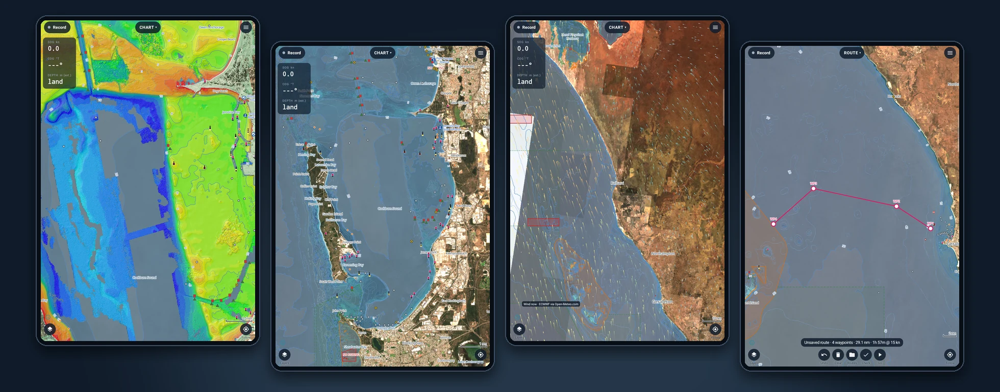

Depths, contours, fishing zones, reef relief, satellite, tides, wind, swell, bag limits and a catch log. Works with no
signal. Built only from free public data.

> ⚠️ **NOT FOR NAVIGATION.** A hobby project, not an official chart (those come from the Australian Hydrographic
> Office). Rocks, reefs, bars and wrecks are missing and depths can be badly wrong. Depths are from about mean sea
> level, so there is **less water than shown at low tide**. Zones may be incomplete or out of date: check the rules with
> [DPIRD](https://www.dpird.wa.gov.au/) and [Parks Australia](https://parksaustralia.gov.au/marine/). Use at your own risk.

## Install

Android 8.0 or newer. From the [**latest release**](https://github.com/wufle/chompchamp/releases/latest):

| File | What it is | Needed? |
|---|---|---|
| `chompchamp-<version>.apk` | The app | Yes |
| `wa.pmtiles` (~125 MB) | Offline chart: depths, contours, coast, zones | Yes, or the map is blank |
| `wa-relief.pmtiles` (~55 MB) | Offline 5 m seabed imagery, ~30 nearshore areas | Optional (streams when online) |
| `chompchamp-planner.html` | [Planner](#planner-pc-and-iphone) for PC (also [on the web](https://wufle.github.io/chompchamp/)) | Optional |

1. **Install the APK.** Allow "install unknown apps" when asked. It isn't on the Play Store, so Play Protect may warn.
2. **Add the chart:** ☰ → **Charts, offline areas & updates… → Check for updates… → Download…**, or download
   `wa.pmtiles` and use **Import chart or relief file…** (don't unzip or rename it).
3. **Seabed imagery (optional):** same again with `wa-relief.pmtiles`.
4. **Allow location.**
5. **Satellite offline (optional):** ☰ → Charts, offline areas & updates… → **Save an area for offline use…**, fill the
   screen with your area, **Download this area**.

**Updates:** ☰ → Charts, offline areas & updates → **Check for updates…** downloads a new app, chart or relief pack
from GitHub. Your data is kept. Automatic checks are off unless you turn them on in Settings. Uninstalling deletes
your data, so export first (☰ → Data). Photos aren't exported yet.

**Problems?** *Blank map:* no chart imported, or you're outside WA. *"App not installed":* an older copy was signed with
a different key; export, uninstall, reinstall. *"That isn't a .pmtiles chart file":* a zip or partial download.

Official builds are signed with this certificate (SHA-256):
`0D:D2:B4:04:B7:83:0C:A0:D3:0F:F4:CD:2A:69:5C:17:57:E0:1A:1B:6F:D2:42:18:CF:38:CB:96:32:F0:D6:46`

## What it does

Four modes, from the button at the top:

- **Chart:** depth shading, contours, labels and zones (no fishing red, restricted orange, parks green). Alerts when
  you enter a no-fishing zone. Tap a zone for its rules. Long-press for depth, tide, where the depth came from and how
  good it is, "Navigate here" or "Add mark".
- **Route:** tap to add waypoints. Distance and time, saved routes, and **Check** for land, shallows and no-fishing zones.
- **Navigate:** BRG, DTW, XTE, VMG, TTG and ETAs; advances at the arrival radius or abeam.
- **Fish:** drift prediction, anchor alarm, nearest mark. **Mark** logs the catch and spot together (species, size,
  kept/released, bait, photos), warning before you keep a protected, closed, undersize or over-bag fish.

| Chart | Route | Long-press |
|:---:|:---:|:---:|
| 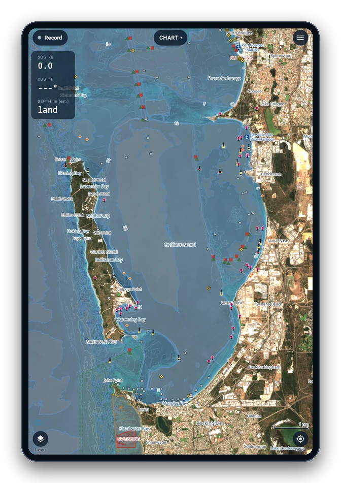 | 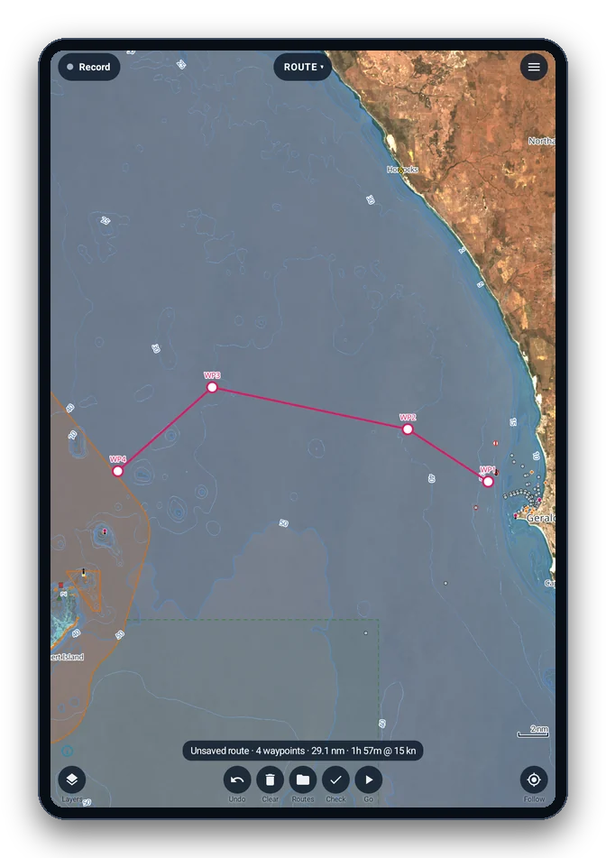 | 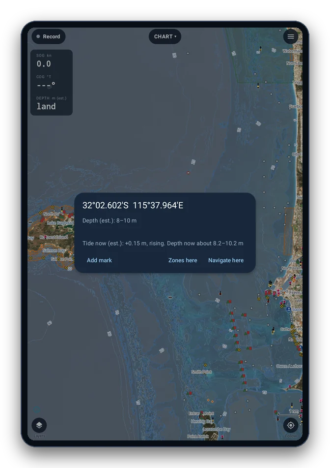 |
| <sub>Cockburn Sound, from 5 m surveys</sub> | <sub>Geraldton to the Abrolhos</sub> | <sub>Depth, tide and depth now</sub> |

Also in the ☰ menu:

- **Search places:** towns, ramps, jetties, islands, reefs, bays. Ramps show lanes and trailer bays. Offline.
- **Bag & size limits:** for where you are, with pictures and closed seasons. Copied by hand from DPIRD's guide and not
  self-updating, so check the [current rules](https://www.dpird.wa.gov.au/individuals/recreational-fishing/recreational-fishing-rules/recreational-bag-and-size-limits/).
- **Trips & catches:** tap **Record** (or start a route, or mark a catch). Hold it to stop. Keeps recording with the screen
  off. Each trip has its track, speed chart, stats and catches; export as GPX or CSV.
- **Wind, waves & tide:** wind streaks and sea & swell on the map, week charts, and tides worked out on the device
  (EOT20; within ~0.1 m of the Fremantle, Esperance, Port Hedland and Broome gauges). Forecasts download for the area on
  screen and are kept for offline use.
- **Vessels (AIS)** (online): nearby boats from volunteer stations. For interest, not collision avoidance.

| Bag & size limits | Zone details | Zones |
|:---:|:---:|:---:|
| 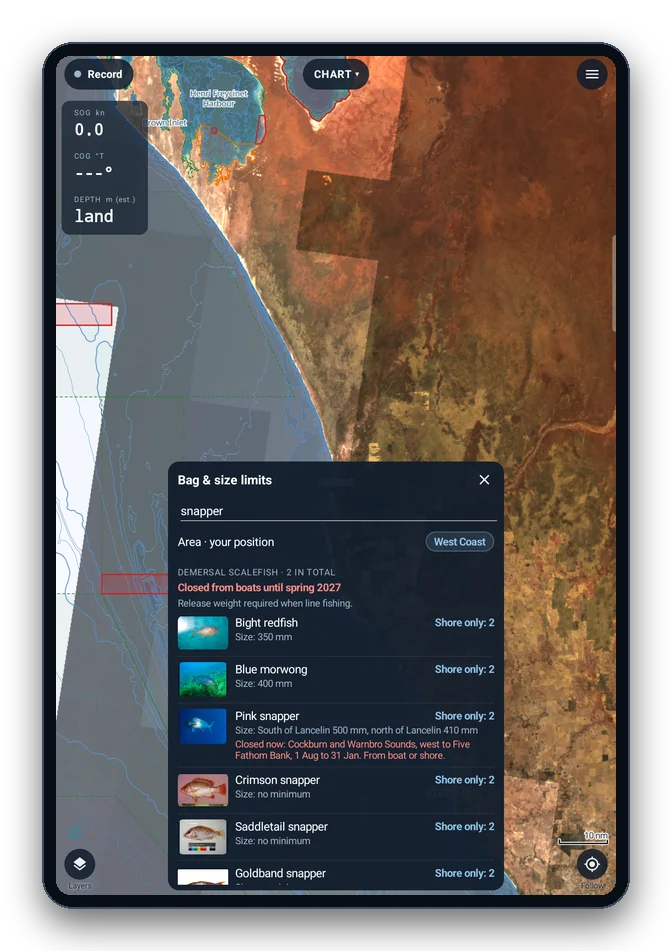 | 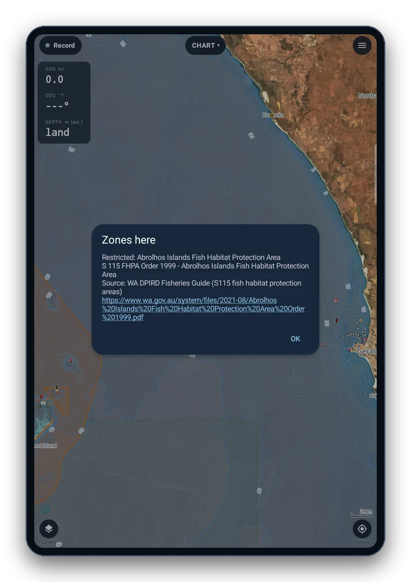 | 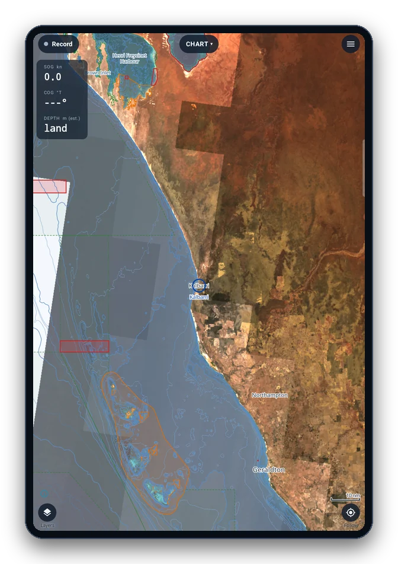 |
| <sub>Limits where you are</sub> | <sub>Tap a zone for its rules</sub> | <sub>Kalbarri to the Abrolhos</sub> |

| Wind | Sea & swell | Tide |
|:---:|:---:|:---:|
| 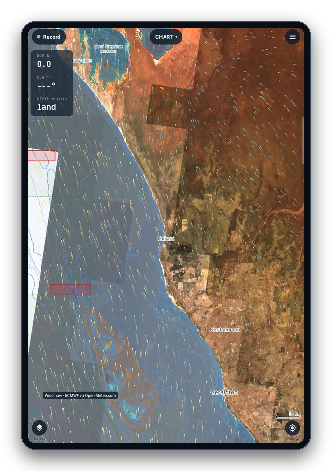 | 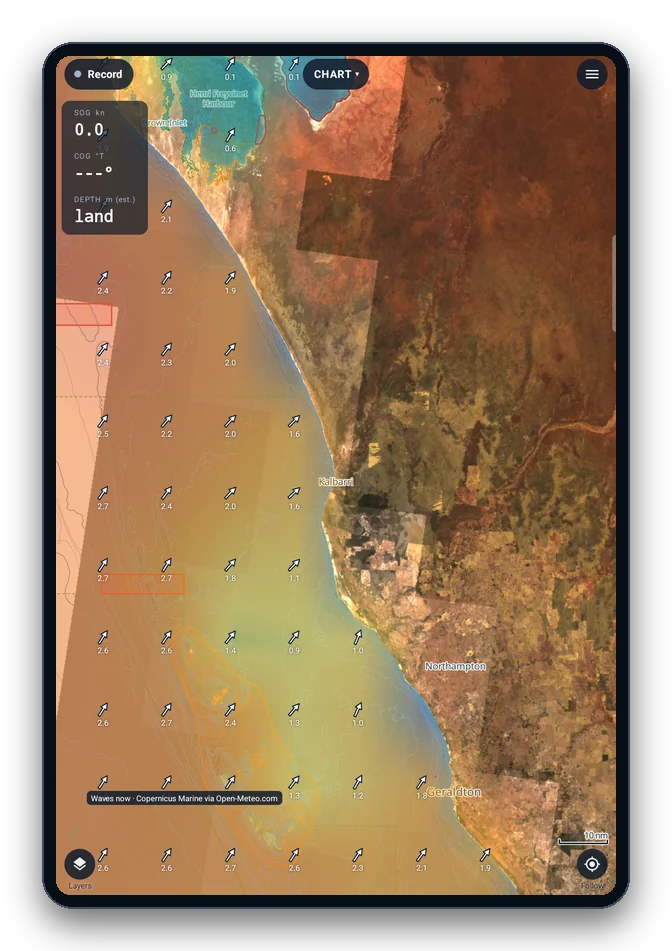 | 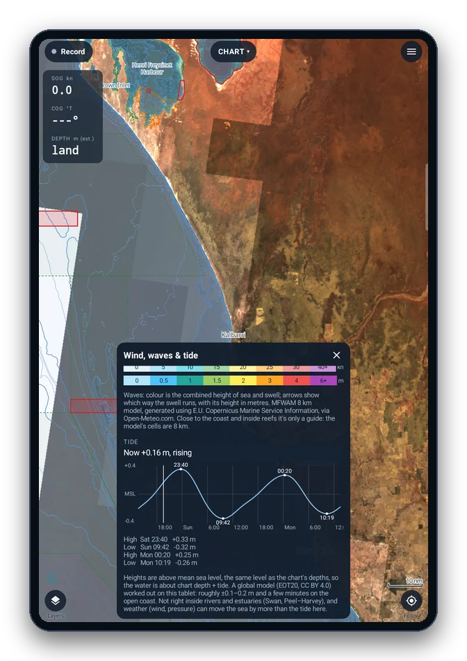 |
| <sub>ECMWF 9 km</sub> | <sub>Height and swell direction</sub> | <sub>Worked out offline</sub> |

**Make it yours:** data fields per mode (drag, resize, group), every layer on/off with its own opacity, button and panel
size and transparency, and your boat: tinny, yacht, kayak, rubber duck, pirate ship and more. **Data:** snapshots,
backup files and GPX import/export.

| Layers | Display |
|:---:|:---:|
| 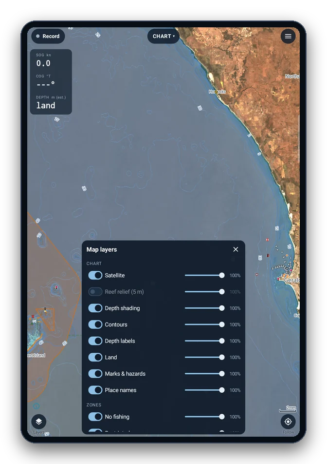 | 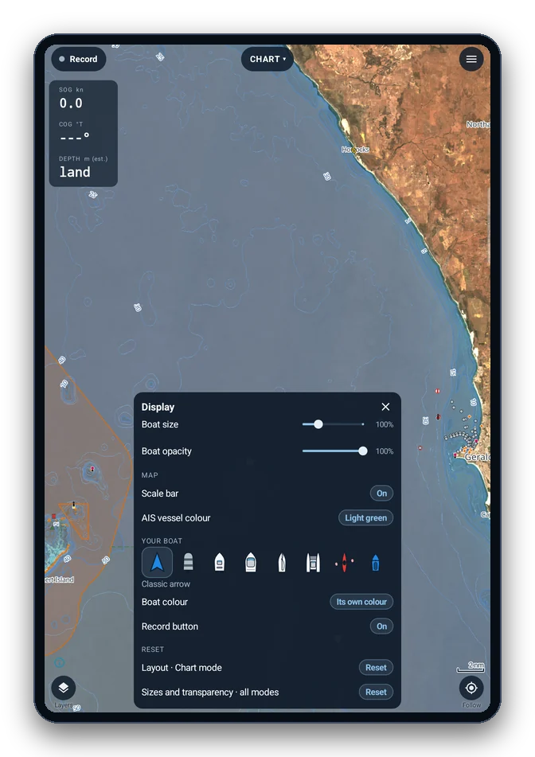 |

### Layer by layer

Each layer comes from its own free source, and each can be switched off or faded. Here they are over Rottnest Island:

<p align="center">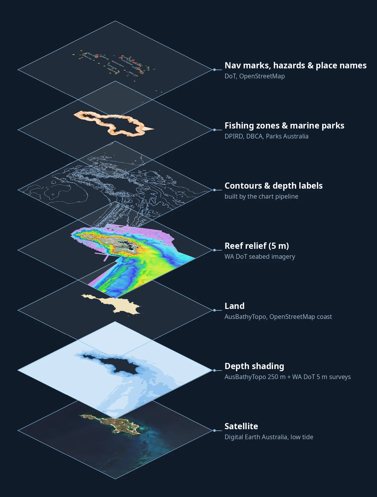</p>

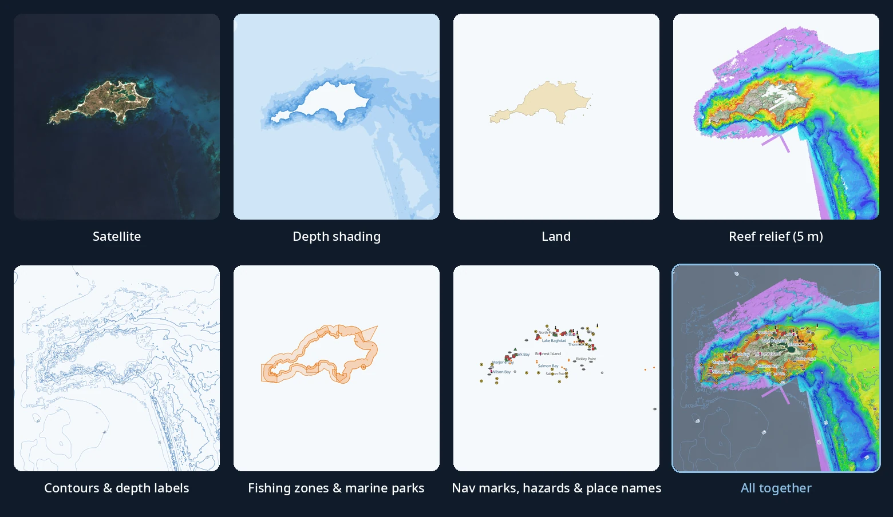

### Cockburn Sound up close

From Two Rocks to Preston Beach, Kalbarri to Horrocks, and Dongara, depths come from WA DoT 5 m surveys, not the 250 m
national grid. With reef relief on, you see the seabed: channels, banks and the deep basin.

| Reef relief | Closer: Woodman Point | Same spot, chart only |
|:---:|:---:|:---:|
| 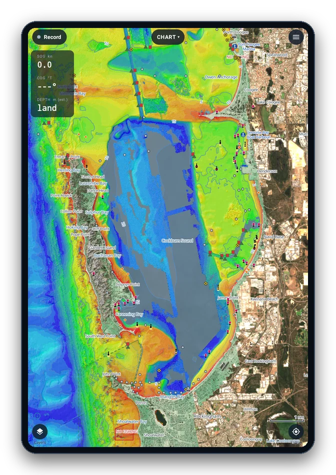 | 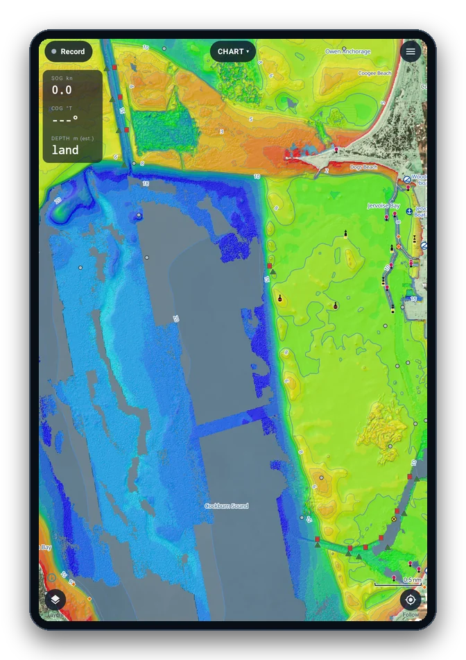 | 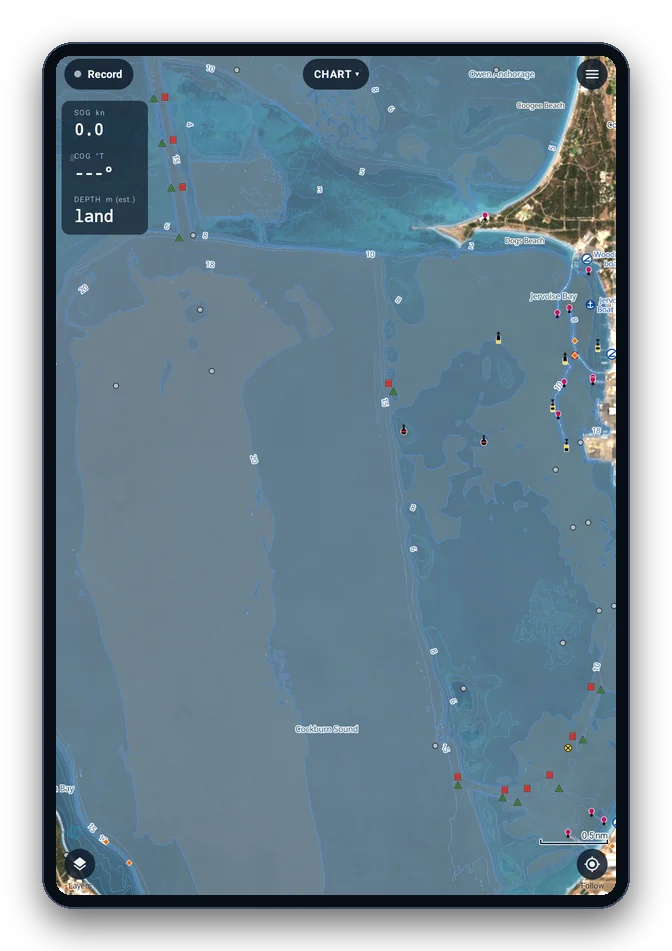 |

## Planner (PC and iPhone)

The phone app in a browser, reading the same `wa.pmtiles`, offline once opened: same modes, panels, data fields,
tides, wind, AIS, trips and catch log. Swap data with the phone by backup or GPX. It can't save satellite imagery
offline or keep photos.

- **PC:** download `chompchamp-planner.html` and `wa.pmtiles`, open the HTML and pick the chart (once). Right-click
  where the phone long-presses. Keep the file's name and place: some browsers tie your data to it.
- **iPhone:** in Safari, download `wa.pmtiles`, open [wufle.github.io/chompchamp](https://wufle.github.io/chompchamp/),
  **Share → Add to Home Screen**, open it from there and pick the chart. GPS only runs while it's open with the screen
  on. Not yet tested on a real iPhone.

Data stays in that browser, so export a backup now and then.

## Privacy

No accounts, ads or analytics. Your position, trips, catches, marks and photos stay on the phone unless you export
them (or Android's device backup copies them). Your position is never sent. Online, these see your IP address and the
area on screen:

- **Map imagery:** WA Government (SLIP) and Digital Earth Australia.
- **Wind and waves:** Open-Meteo, when a forecast downloads.
- **AIS layer:** Open Waters, about once a minute (logs kept 90 days).
- **Update checks:** GitHub, only when you ask or turn on automatic checks.
- **Google Images** on a fish opens a Google search.

## Data sources and licences

The code is [MIT](LICENSE). **The data isn't:** each layer keeps its source's licence (including the bundled
`hazards.geojson` and `places.geojson`). **Marine park outlines are non-commercial**, so don't sell charts with them.

| Layer | Source | Licence |
|---|---|---|
| Depth, contours, land (statewide, 250 m) | Geoscience Australia, [AusBathyTopo (Australia) 250m 2024](https://pid.geoscience.gov.au/dataset/ga/150050). Incorporates source bathymetry data reproduced under licence by permission of the Australian Hydrographic Office © Commonwealth of Australia 2009-2023 | CC BY 4.0 |
| Depth, contours: Two Rocks to Preston Beach, Rottnest, Cockburn Sound, Swan and Canning rivers, Mandurah, Dawesville Cut, Peel–Harvey | WA Department of Transport 5 m composite grids (DOT-022) and point soundings (DOT-021). Heights relative to AHD (about mean sea level), not chart datum | CC BY 4.0 |
| Depth, contours: Kalbarri to Horrocks | WA Department of Transport 5 m grid (DOT-022) and soundings (DOT-021); south of 28° S also LiDAR and multibeam from Geoscience Australia's [AusBathyTopo 30m (Perth) 2026](https://ecat.ga.gov.au/geonetwork/srv/eng/catalog.search#/metadata/61a348f7-077f-476a-b8a2-b8e3feb2a304), incorporating data © Commonwealth of Australia (AHO) | CC BY 4.0 |
| Depth, contours: Dongara (Cliff Head to Seven Mile Beach) | LiDAR from Geoscience Australia's [AusBathyTopo 30m (Perth) 2026](https://ecat.ga.gov.au/geonetwork/srv/eng/catalog.search#/metadata/61a348f7-077f-476a-b8a2-b8e3feb2a304), incorporating data © Commonwealth of Australia (AHO); WA Department of Transport 5 m grid (DOT-022) and soundings (DOT-021), 1991–2011 | CC BY 4.0 |
| Coastline, river, estuary and marina outlines (detailed areas) | © [OpenStreetMap contributors](https://www.openstreetmap.org/copyright) | ODbL 1.0 |
| No-fishing / restricted zones | WA DPIRD Fisheries Guide, consolidated notices and orders (DPIRD-061), via [SLIP](https://public-services.slip.wa.gov.au/public/rest/services/SLIP_Public_Services/DPIRD_Fisheries_Guide/MapServer) | CC BY 4.0 |
| State marine park outlines | WA DBCA Legislated Lands and Waters (DBCA-011) | CC BY-NC 4.0 (non-commercial) |
| Commonwealth marine park zones | Australian Marine Parks © Commonwealth of Australia (DCCEEW), via [Parks Australia](https://gis.environment.gov.au/gispubmap/rest/services/ogc_services/Australian_Marine_Parks/FeatureServer) | CC BY 4.0 |
| Reef relief (5 m, ~30 nearshore areas) | WA Department of Transport bathymetry imagery, via [SLIP](https://public-services.slip.wa.gov.au/public/rest/services/Landgate_Public_Maps/WA_Bathymetry/MapServer) | CC BY 4.0 |
| Navigation marks | WA Department of Transport, Navigation Aids (DOT-004), via SLIP | CC BY 4.0 |
| Wrecks, rocks, obstructions | © OpenStreetMap contributors (OpenSeaMap seamark tags) | ODbL 1.0 |
| Place names | © OpenStreetMap contributors | ODbL 1.0 |
| Boat ramps, harbours, public jetties | WA Department of Transport, Public Boat Ramps (DOT-033) and Maritime Facility Locations (DOT-030), via SLIP | CC BY 4.0 |
| Wind forecast | [Open-Meteo.com](https://open-meteo.com/), ECMWF IFS 9 km open data | CC BY 4.0 |
| Wave forecast (sea and swell) | MFWAM via [Open-Meteo.com](https://open-meteo.com/): generated using E.U. Copernicus Marine Service Information ([doi:10.48670/moi-00017](https://doi.org/10.48670/moi-00017)) | Copernicus Marine licence (free, with attribution) |
| Tide predictions | EOT20 global ocean tide model, Hart-Davis et al. 2021, DGFI-TUM ([doi:10.17882/79489](https://doi.org/10.17882/79489)) | CC BY 4.0 |
| Satellite | © Geoscience Australia, [Digital Earth Australia](https://www.dea.ga.gov.au): coast from [DEA Tidal Composites](https://knowledge.dea.ga.gov.au/data/product/dea-tidal-composites/) (Sentinel-2, low tide, 2024), inland from [DEA GeoMAD](https://knowledge.dea.ga.gov.au/data/product/dea-geometric-median-and-median-absolute-deviation-landsat/) (Landsat 8 and 9, 2025). Contains modified Copernicus Sentinel and USGS Landsat data | CC BY 4.0 |
| Vessels (AIS) | [Open Waters AIS](https://openwaters.io/ais/), passing on AIS from [AISHub](https://www.aishub.net) contributors and [aisstream.io](https://aisstream.io) | Not open data. Free for personal use and display with credit; AISHub's terms don't allow passing on the raw data, so the app never stores or exports it. aisstream.io publishes no licence |
| Bag and size limits | Facts from WA DPIRD's [Recreational fishing guide 2026](https://www.dpird.wa.gov.au/siteassets/documents/fisheries/recreational/guides-and-infographics/recreational-fishing-guide.pdf) (June 2026, edition 2), checked 25 November 2026. The guide is © State of Western Australia with no open licence, so only the limits, dates and places are used, in our own words | Not open data |
| Closure areas for bag limits | WA DPIRD Fisheries Guide (DPIRD-061), via SLIP, simplified | CC BY 4.0 |
| Species pictures | [iNaturalist](https://www.inaturalist.org) observers and [Wikimedia Commons](https://commons.wikimedia.org) contributors, resized. Credits in [species_images.json](pipeline/species_images.json) and in the app | Public domain, CC0, CC BY or CC BY-SA, by picture |
| Label font | Noto Sans, via [OpenFreeMap](https://openfreemap.org) glyphs | SIL OFL 1.1 |

**Zone classification** (`pipeline/scripts/fetch_zones.py`) goes by each area's schedule heading, not the order's
title: marine park orders ban fishing park-wide, then allow it back by schedule.

- `notake` (red): sanctuaries, wreck sites, single-area "Prohibition on Fishing" orders (Burswood Lake, Esperance Jetty,
  Greens Pool, Hamelin Pool, Bernier Island), and Commonwealth National Park (II) and Sanctuary (Ia) zones.
- `restricted` (orange): recreation, special purpose and protected areas, fish habitat protection areas, Abrolhos reef
  observation areas, gear and netting rules. Fishing allowed with limits.
- `park` (green outline): general use and other marine park waters.
- Commercial-only closures and whole-park schedules are skipped.

Depth and no-fishing alerts read the chart file, so they work with the boat off screen (and vibrate with the screen
off while recording). The route check reads the map on screen, zooming out to fit the route first. Isolated rocks
known only from official surveys (AHO ENCs) aren't in any free dataset.

## Roadmap

- [ ] More high-detail areas from WA DoT surveys
- [ ] Newer national depth grid (AusBathyTopo 2026), and GA's 30 m Northern Australia grid
- [ ] Depths adjusted to chart datum
- [ ] Photos in backups
- [ ] Sea surface temperature and chlorophyll (IMOS)
- [ ] DoT tide stations and marine weather
- [ ] Other states

Done: offline fonts, off-screen zone alerts, offline satellite, in-app updates, planner with GPS, tides, weather and
catches, bag and size limits.

## For developers

```
android/     Kotlin app, MapLibre Native, reads a local .pmtiles chart
pipeline/    Builds the offline chart (wa.pmtiles) and relief pack from public data
web/         Planner: plain JavaScript, built into one HTML file and the website
branding/    Logo; make_icon.py writes the launcher icons
.github/     CI: APK on every push to android/; chart and relief on demand
```

- **App:** `cd android && ./gradlew assembleDebug` (JDK 17 + Android SDK). Every push builds an APK artifact (7 days).
- **Chart** (Python 3.12+, GDAL, `unzip`, `curl`, tippecanoe 2.17+; first run downloads ~3 GB):
  ```sh
  python3 -m venv .venv && .venv/bin/pip install -r pipeline/requirements.txt
  PY="$PWD/.venv/bin/python" ./pipeline/build.sh      # -> pipeline/out/wa.pmtiles
  ```
- **Relief pack** (`pip install pillow pmtiles`): `python3 pipeline/scripts/build_relief.py pipeline/out/wa-relief.pmtiles`
- **Refresh bundled data:** `fetch_zones.py pipeline/build/zones.geojson`, `fetch_hazards.py` and `fetch_places.py`
  (into `android/app/src/main/assets/`), and `fetch_tides.py /tmp/eot20` (2.3 GB; numpy, scipy, netCDF4), all in
  `pipeline/scripts/`.
- **Workflows:** *Build WA chart data* and *Build WA reef relief pack* make artifacts, and only publish a release if
  **publish** is ticked.
- **Planner:** `python3 web/build.py`, test with `node web/test.mjs`, publish with `gh workflow run planner.yml -f deploy=true`.

Outside the detailed areas the 250 m grid is smoothed before contouring: it looks better but adds no detail.

### Signing

Every APK must be signed with the same key or Android won't update the app. CI reads it from three secrets:
`ANDROID_KEYSTORE_B64` (base64 PKCS12 keystore), `ANDROID_KEYSTORE_PASSWORD` and `ANDROID_KEY_ALIAS`. Create them once
with `scripts/create-signing-key.sh` (needs `openssl` and `gh`) and back up the keystore outside the repo. Forks get a
throwaway key (`-tempkey` in the filename) and can't update an official install.
